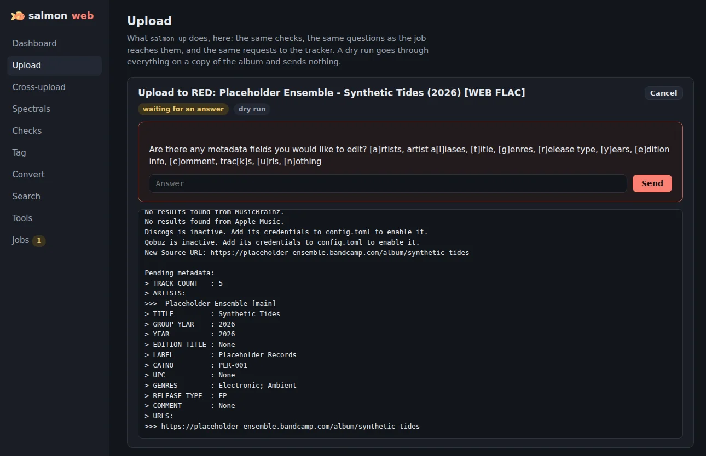
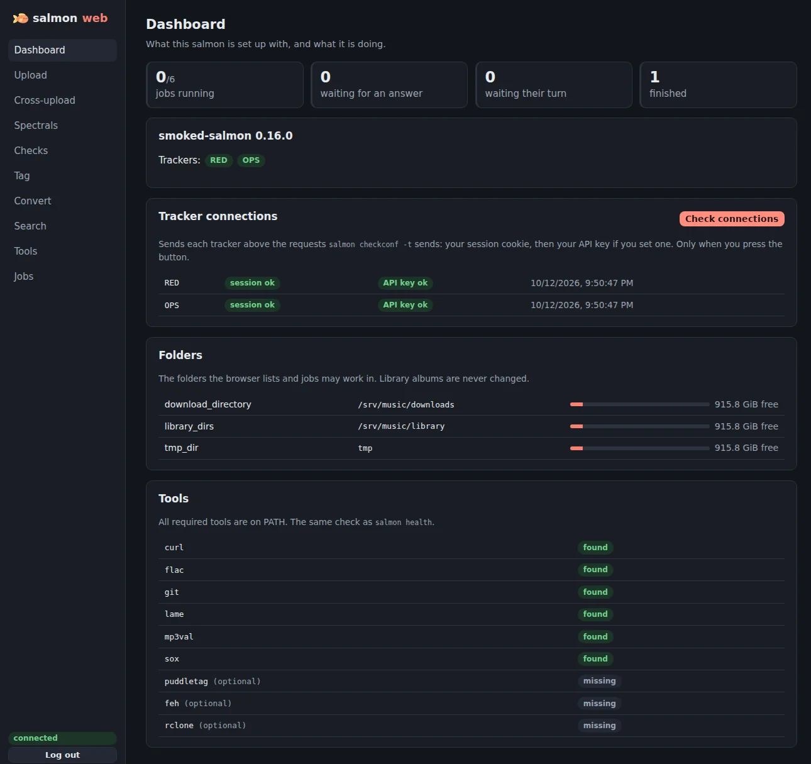
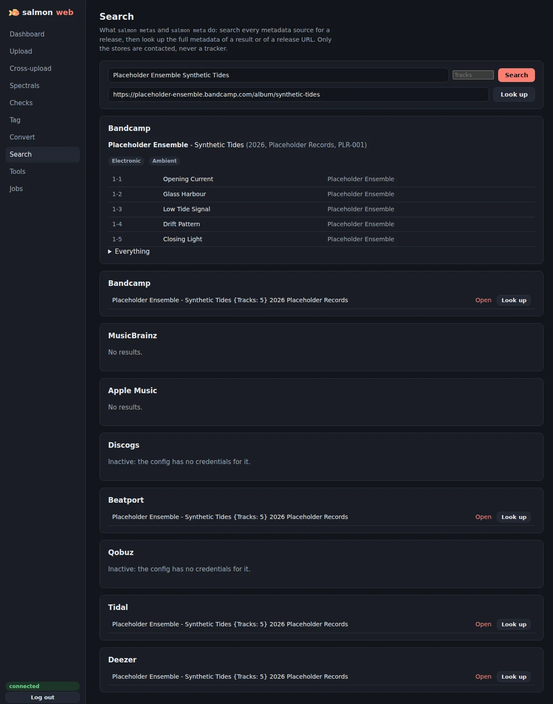
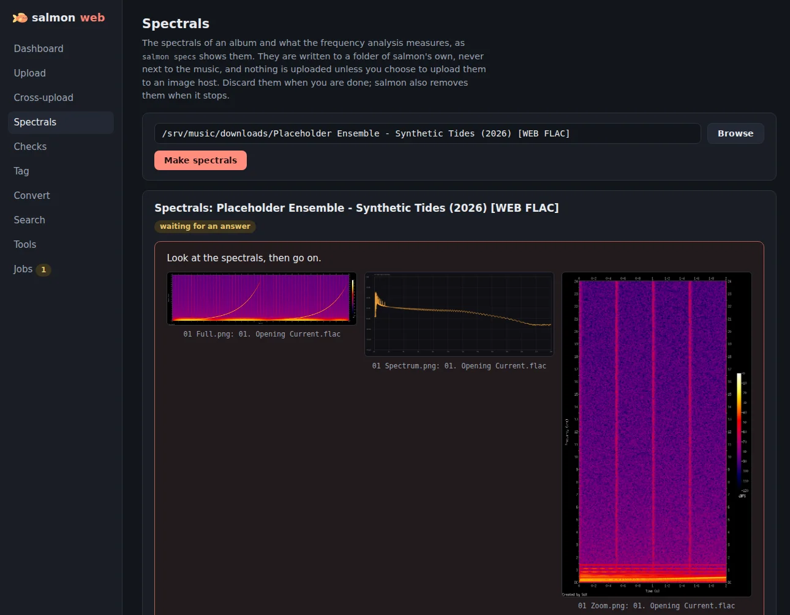
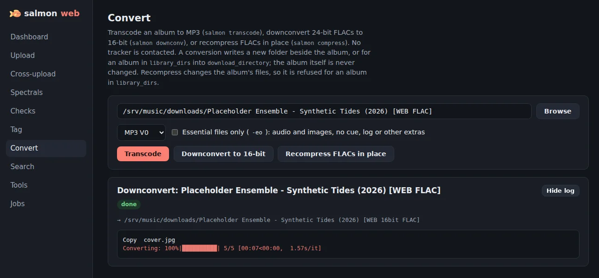
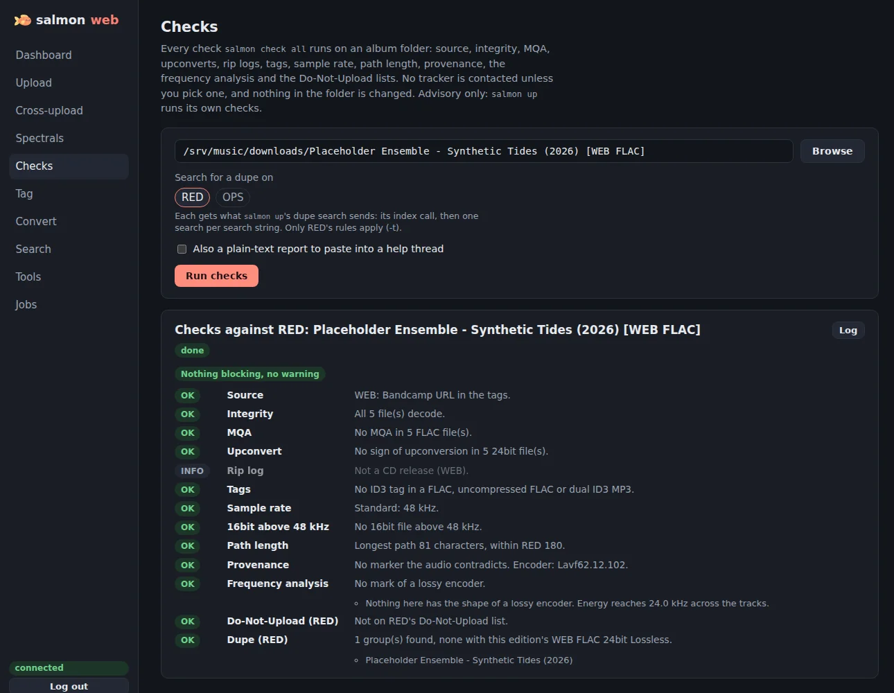
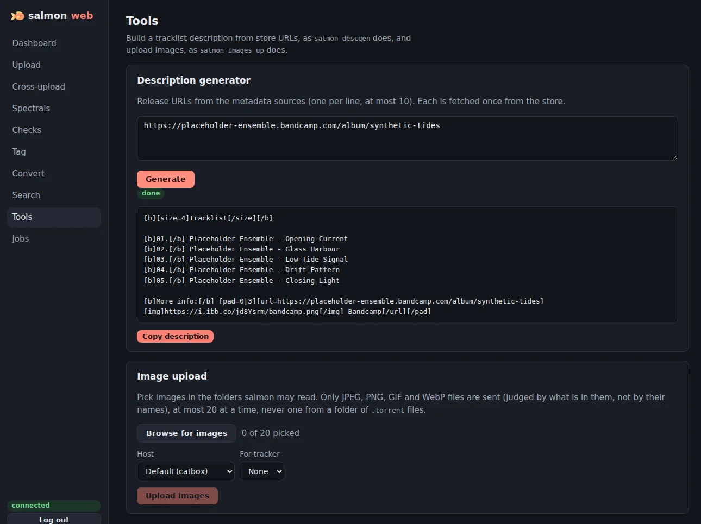
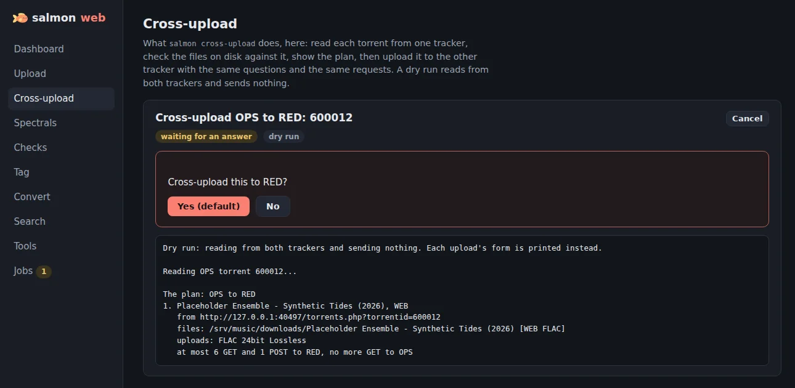
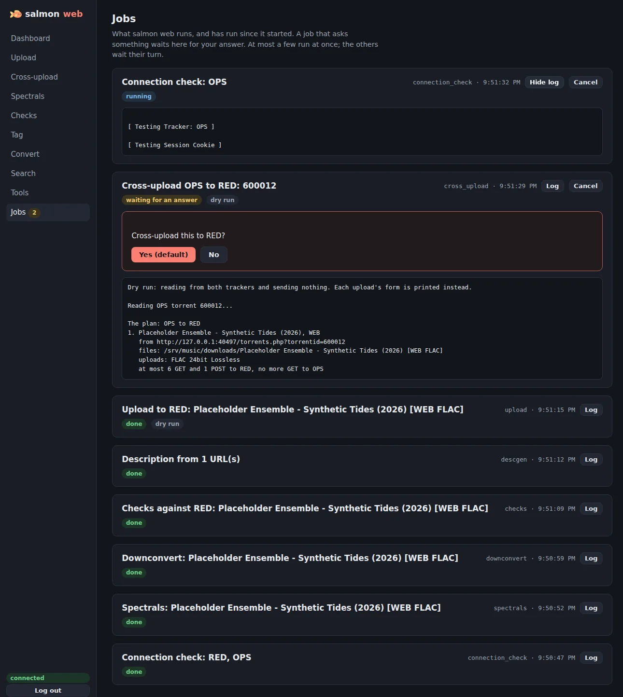

[](https://github.com/smokin-salmon/smoked-salmon/actions/workflows/docker-image.yml) [](https://github.com/smokin-salmon/smoked-salmon/actions/workflows/lint.yml)

# 🐟 smoked-salmon  

A simple tool to take the work out of uploading on Gazelle-based trackers. It generates spectrals, gathers metadata, allows re-tagging/renaming files, and automates the upload process.

## 🌟 Features  

- **Interactive Uploading** – Supports **multiple trackers** (RED / OPS / DIC).
- **Log Checking** – Calculates log scores, verifies log checksum integrity, and validates log-to-FLAC file matching.
- **Upconvert Detection** – Checks 24-bit flac files for potential upconverts.
- **MQA Detection** – Checks files for common MQA markers.
- **Duplicate Upload Detection** – Prevents redundant uploads.  
- **Do-Not-Upload Lists** – salmon ships a copy of RED's and OPS's Do-Not-Upload lists (fakes, unreleased albums, bootlegs, some whole discographies and labels; some entries only for one media, such as WEB), and never uploads a listed release to that tracker, with or without `-yyy`: it says which entry matched and why, and the run goes on to the other trackers. A legitimate copy needs that tracker's staff approval first. The maintainers update the lists with salmon's releases; `cross-upload` checks the target's list too.  
- **Spectral Analysis** – Generates, compresses, and verifies spectrals, shown on a web page during upload.  
- **Frequency Analysis** – Before the lossy-master question, measures the two marks a lossy encoder leaves in each track: a brick-wall lowpass where MP3 and AAC encoders cut, and highs that flip between content and digital silence. It prints what it measured, shows an averaged-spectrum plot next to each track's spectrals (kept local, never uploaded), and makes "yes" the question's default when a track carries the marks. It is a measurement, not a verdict: high-bitrate AAC can leave neither mark.  
- **Spectral Upload** – Can generate spectrals for an existing upload (based on local files), and update the release description.  
- **Lossy Master Report Generation** – Supports lossy master reports during upload.
- **Metadata Retrieval** – Fetches metadata from:
  - Apple Music, Bandcamp, Beatport, Deezer, Discogs, MusicBrainz, Qobuz, Tidal.
- **File Management** –  
  - Retags and renames files to standard formats (based on metadata).
  - Checks file integrity and sanitizes if needed.  
- **Request Filling** – Scans for matching requests on trackers.
- **Description generation** – Edition description generation (tracklist, sources, available streaming platforms, encoding details...).
- **Down-convert and Transcode** – Can downconvert 24-bit flac files to 16-bit, and transcode to mp3.
- **Multi-Format Upload** – Automatically transcodes and uploads multiple formats (FLAC 16-bit, MP3, etc.) in a single workflow.
- **Torrent Client Injection** – Can inject generated torrent files into torrent clients (qBittorrent, Transmission, Deluge, ruTorrent).
- **Remote Seeding** – Can transfer files to multiple remote locations via rclone and inject torrents into remote torrent clients for automatic seeding.
- **Update Notifications** – Informs users when a new version is available.

## 📥 Installation  

Manual installation instructions can be found on the [Wiki](https://github.com/smokin-salmon/smoked-salmon/wiki/Installation).

### 🔹  Install smoked-salmon 
These steps use [`uv`](https://github.com/astral-sh/uv) for installing the *smoked-salmon* package. [`pipx`](https://github.com/pypa/pipx) also works.
Installing with pip is not recommended because uv (and pipx) manage python versions and isolate the *smoked-salmon* installation from the system python installation.
If smoked-salmon runs on Python 3.14 (uv may pick it on a fresh install), spectral images are uploaded uncompressed because oxipng is not available for it yet; to have them compressed, install with `uv tool install --python 3.13 git+https://github.com/smokin-salmon/smoked-salmon` instead, or install the oxipng program (winget, scoop, brew, apt, or its [GitHub releases](https://github.com/oxipng/oxipng/releases)), which salmon uses when it finds it.

#### Linux
1. Install system packages:
    ```bash
    sudo apt install sox libsox-fmt-mp3 flac mp3val curl lame
    ```
    Debian and Ubuntu's `sox` package reads MP3 files only when `libsox-fmt-mp3` is also installed.

2. Install uv:
    ```bash
    curl -LsSf https://astral.sh/uv/install.sh | sh
    ```

3. Install smoked-salmon package from github:
	```bash
	uv tool install git+https://github.com/smokin-salmon/smoked-salmon
	```

#### Windows
Run these commands in **PowerShell** (Start menu, "Windows PowerShell"), not in Command Prompt (`cmd`). They fail in Command Prompt.

1. Install required system packages using winget:
    ```powershell
    winget install -e ChrisBagwell.SoX Xiph.FLAC LAME.LAME ring0.MP3val.WF
    ```
    Then close PowerShell and open a new window, so it finds the new programs.

2. Fix sox Unicode filename handling issue on Windows:
    ```powershell
    $soxDir = $((Get-Command sox).Source | Split-Path)
    $zipPath = Join-Path -Path $soxDir -ChildPath "sox_windows_fix.zip"
    Invoke-WebRequest -Uri "https://raw.githubusercontent.com/DevYukine/red_oxide/master/.github/dependency-fixes/sox_windows_fix.zip" -OutFile $zipPath
    Expand-Archive -Path $zipPath -DestinationPath $soxDir -Force
    regedit "$soxDir\PreferExternalManifest.reg"
    Remove-Item $zipPath
    ```

3. Install uv:
    ```powershell
    powershell -ExecutionPolicy ByPass -c "irm https://astral.sh/uv/install.ps1 | iex"
    ```
    Then close PowerShell and open a new window, so it finds `uv`.

4. Install smoked-salmon package from github:
	```powershell
	uv tool install git+https://github.com/smokin-salmon/smoked-salmon
	```
    smoked-salmon has no window or Start menu entry: you type `salmon` in PowerShell (see Initial Setup below).
    If PowerShell says `salmon` is not recognized, run `uv tool update-shell`, then open a new PowerShell window.

#### macOS
1. Install Homebrew (if you haven't already):
    ```bash
    /bin/bash -c "$(curl -fsSL https://raw.githubusercontent.com/Homebrew/install/HEAD/install.sh)"
    ```

2. Install system packages using Homebrew:
    ```bash
    brew install sox flac mp3val curl lame
    ```

3. Install uv:
    ```bash
    curl -LsSf https://astral.sh/uv/install.sh | sh
    ```

4. Install smoked-salmon package from github:
	```bash
	uv tool install git+https://github.com/smokin-salmon/smoked-salmon
	```

### 🔹  Initial Setup
smoked-salmon is a command-line program: run every `salmon` command in a terminal (PowerShell on Windows).

1. Run salmon for the first time. It offers to create a default configuration file and prints where it is:
	```
	salmon-user@salmon:~$ salmon
	Could not find configuration path at /home/salmon-user/.config/smoked-salmon/config.toml.
	Do you want smoked-salmon to create a default config file at /home/salmon-user/.config/smoked-salmon/config.toml? [y/N]:
	```

2. Edit the `config.toml` file with your preferred text editor to add your API keys, session cookies and update your preferences (see the [Configuration Wiki](https://github.com/smokin-salmon/smoked-salmon/wiki/Configuration)).

3. Use the `checkconf` command to verify that the connection to the trackers is working:

	```
	salmon checkconf
	```

4. Use the `health` command to verify that all necessary command line dependencies are installed:
	```
	salmon health
	```

### 🐳 Docker Installation

A Docker image is generated per release (`:latest`) and on every push to `master` (`:alpha`).  
Feedback on this guide is welcome.

1. Pull the image:

   ```bash
   # Stable release
   docker pull ghcr.io/smokin-salmon/smoked-salmon:latest

   # Alpha (built on every push to master, equivalent to `uv tool install git+...`)
   docker pull ghcr.io/smokin-salmon/smoked-salmon:alpha
   ```

   > The examples below use the `latest` tag. Replace with `alpha` to use the latest development version.

2. Copy the content of the file [`config.toml`](https://github.com/smokin-salmon/smoked-salmon/blob/master/src/salmon/data/config.default.toml) to `config.toml` in a directory on your host server; this directory gets mounted at `/config` in the container.
   Edit the `config.toml` file with your preferred text editor to add your API keys, session cookies and update your preferences (see the [Configuration Wiki](https://github.com/smokin-salmon/smoked-salmon/wiki/Configuration)).

3. Configure rclone if needed by copying your host's rclone config (`rclone config file` prints its path) into the same directory, as `/config/rclone.conf`.

> The image sets `SALMON_CONFIG_DIR=/config`, so a single mount holds `config.toml`
> (and `rclone.conf`). If you are upgrading an image that mounted
> `/root/.config/smoked-salmon/` directly, that old mount still works, but move
> `config.toml` into the new `/config` mount when you can.

---

### 🔁 Docker Usage

1. **Check Configuration**
   Run the container with the `checkconf` command to verify that the connection to the trackers is working:

   ```bash
   # The -e RCLONE_CONFIG line is optional: only needed if you use rclone features.
   docker run --rm -it --network=host \
   -v /path/to/your/music:/app/.music \
   -v /path/to/your/config:/config \
   -v /path/to/your/generated/dottorrents:/app/.torrents \
   -e RCLONE_CONFIG=/config/rclone.conf \
   ghcr.io/smokin-salmon/smoked-salmon:latest checkconf
   ```

2. **Upload**
   Run the upload command directly (replace `checkconf` with any salmon command):

   ```bash
   # The -e RCLONE_CONFIG line is optional: only needed if you use rclone features.
   docker run --rm -it --network=host \
   -v /path/to/your/music:/app/.music \
   -v /path/to/your/config:/config \
   -v /path/to/your/generated/dottorrents:/app/.torrents \
   -e RCLONE_CONFIG=/config/rclone.conf \
   ghcr.io/smokin-salmon/smoked-salmon:latest up "/app/.music/path/to/album" -s WEB
   ```

### 💡 Shell Alias (Optional)

To avoid repeating the long `docker run` command, add the following alias to your shell configuration file (`~/.bashrc`, `~/.zshrc`, etc.):

```bash
alias salmon='docker run --rm -it --network=host \
  -v /path/to/your/music:/app/.music \
  -v /path/to/your/config:/config \
  -v /path/to/your/generated/dottorrents:/app/.torrents \
  -e RCLONE_CONFIG=/config/rclone.conf \
  ghcr.io/smokin-salmon/smoked-salmon:latest'
```

Then use it just like a native install:

```bash
salmon checkconf
salmon health
salmon up "/app/.music/path/to/album" -s WEB
```

---

### ⚠️ Notes

- **Permission Issues**  
  The container does not manage file ownership for you.  
  If your torrent client is not run as root, or if new uploads are inaccessible, you may need to:
  - Manually adjust file/folder ownership (`chown`) or permissions (`chmod`)
  - Ensure the container and torrent client users are compatible
  - Optionally run containers with matching `--user` flags or add `umask` logic
     ```bash
    user: "1001:100"
    environment:
      - PUID=1001
      - PGID=100
     ```

- **Hardlinks**  
  With `hardlinks = true` (the default), salmon hardlinks the release into `download_directory` instead of copying it. A hardlink cannot cross mounts, even two bind mounts of the same disk, so point `download_directory` at a folder inside the music mount (e.g. `/app/.music/seeding`). Otherwise salmon falls back to a full copy.
  An album whose files already have another hardlink, or that is or holds a symlink (for example a folder your torrent client seeds, hardlinked into your music folder), is never retagged in place: `salmon up` and `salmon tag` work on a real copy, which takes the album's size in disk space, and `salmon compress` and the integrity check's sanitize refuse it.

- **.torrent Directory Mapping**  
  Depending on how you've set `dottorrents_dir` in your `config.toml`, you may need to map an additional directory for `.torrent` file output. Add:

  ```bash
  -v /your/host/torrent/output:/app/.torrents
  ```

- **rclone Configuration**  
  If you're using rclone features, put your rclone config file (`rclone config file` prints its path on your host system) in the `/config` mount, alongside `config.toml`, and point rclone at it:

  ```bash
  -e RCLONE_CONFIG=/config/rclone.conf
  ```

---

### 📦 Docker Compose

If using Docker Compose, create a `docker-compose.yml` to define your volume mappings and network settings, then use `docker compose run` to execute any salmon command on demand:

```yaml
services:
  salmon:
    image: ghcr.io/smokin-salmon/smoked-salmon:latest
    network_mode: host
    environment:
      - RCLONE_CONFIG=/config/rclone.conf  # Optional: only if using rclone features
    volumes:
      - /path/to/your/music:/app/.music
      - /path/to/your/config:/config
      - /path/to/your/generated/dottorrents:/app/.torrents

```

```bash
# Check configuration
docker compose run --rm salmon checkconf

# Upload
docker compose run --rm salmon up "/app/.music/path/to/album" -s WEB
```

## 🚀 Usage

### 🎨 Terminal Colors
smoked-salmon uses distinct terminal colors for different types of messages:

* Default – General information
* Red – Errors or critical failures
* Green – Success messages
* Yellow – Information headers
* Cyan – Section headers
* Magenta – User prompts

### 🔧 CLI Mode
smoked-salmon runs in CLI mode, or in your browser with `salmon web` (see below). The spectral review in `up` also launches a small web server. Quick start usage instructions can be found on the [Wiki Usage page](https://github.com/smokin-salmon/smoked-salmon/wiki#usage).

The examples below show how to run smoked-salmon directly. If you're using Docker, you'll need to adjust them accordingly, but the underlying principles remain the same.

To see the available commands, just type:
```bash
salmon
```

To test the connection to the trackers, run:
```bash
salmon checkconf
```

To check the status of salmon's command line and config dependencies, run:
```bash
salmon health
```

To start an upload (with the WEB source):
```bash
salmon up /data/path/to/album -s WEB
```

If you know the store page of the release, give it with `--source-url` and add `--skip-search` to take the
metadata from that page without searching the stores (the review that follows is unchanged). If the page is
not one salmon scrapes, or the scrape fails, salmon searches as usual:
```bash
salmon up /data/path/to/album -s WEB --source-url https://www.qobuz.com/us-en/album/... --skip-search
```

If the FLAC torrent is already in an existing group, skip re-uploading it and
select the lower formats to transcode and upload:
```bash
salmon up /data/path/to/album -s WEB -g GROUP_ID --skip-flac-upload
```
This only works from a lossless FLAC. The album folder is never modified, since it is most likely the
one seeding that FLAC: salmon copies it into `download_directory/.salmon-staging`, works on the copy,
and removes the copy when the run ends. The transcodes land in `download_directory` as usual.

The transcode descriptions link to the group's FLAC in this release's edition (same media, encoding,
year and edition title, as reviewed; the catalogue number is not compared, since sites and uploaders
write it in different conventions); if there are several, salmon asks which one (with `-yyy` it
stops). Formats the edition already has are flagged as a dupe risk and left out unless you pick them
by number.

After a FLAC upload, salmon offers its conversions: a 24-bit or 16-bit downconversion, MP3 320 and MP3 V0. To
choose which are selected by default, and made with `-yyy`, name them in the config (`conversions` under
`[upload]`; `[]` makes none and asks nothing). To make some for one run, without being asked:
```bash
salmon up /data/path/to/album -s WEB --conversions 16bit
```
Give `24bit`, `16bit`, `320` or `V0`, comma-separated, or `none` or `all`. Formats the edition already has are
left out. Without `--conversions`, every conversion that is possible is still listed and can be picked by number;
the config only changes the default answer.

To see what an upload would send, without sending anything, add `--dry-run`:
```bash
salmon up /data/path/to/album -s WEB --dry-run
```
salmon goes through the whole upload (checks, prompts, review, torrents, transcodes) on a copy of the album
in `download_directory/.salmon-staging`, and prints each upload's form (secrets masked), the torrent's files
and piece size instead of sending it. It only reads from the tracker (the login check and searches), uploads
no image (the form shows a placeholder for each image URL), copies nothing to a seedbox and adds nothing to a
torrent client. The copy, with its torrent files and transcodes, is removed when the run ends.

To upload a torrent that is on RED, OPS or DIC to another of them, from the files you already have:
```bash
salmon cross-upload 123456 RED OPS
```
Give the source torrent's ID, URL or `.torrent` file, up to 5 per run, then the source and target trackers.
The files must be exactly the torrent's, in `download_directory/<the torrent's folder>` (or give the folder
with `--path`). salmon first reads each torrent and checks its files, its log and its images, and shows the
plan. The files are checked against the source torrent's pieces, so an album still downloading (its files
already at full size) is not uploaded: for an ID or URL, salmon downloads the source `.torrent` once (through
the tracker's API with its API key, otherwise with its session cookie; never with a freeleech token). When pieces differ, salmon says how many and asks whether to go on (default no;
`-yyy` stops). From DIC, only a `.torrent` file INPUT gets this check; by ID or URL its files are checked
by size only, and the plan says so. Then, for each release, it checks the target for duplicates as `up` does and uploads it with the
source's group and torrent data. The album folder is never changed: the new torrent seeds from the same files,
and a seedbox only gets the new torrent, not another copy. `--dry-run` reads from both trackers and sends
nothing. A cross-upload to DIC is never marked Self-purchased, Self-rip or Exclusive (it is a re-post, so it is
not asked), and a 24-bit one gets its sample rate as `up` sends it. DIC's support follows chodeus's fork: its
rules and answers have not been checked against DIC itself.

To run every check on an album folder before uploading it, without starting an upload:
```bash
salmon check all /data/path/to/album
salmon check all /data/path/to/album -t RED,OPS --report
```
It prints one row per check (integrity, MQA, upconvert, rip logs, tags, sample rate, path length, provenance,
frequency analysis, the Do-Not-Upload lists, and with `-t` a dupe search): `OK`, `WARN`, `BLOCK`, or `INFO` when
the check does not apply. It exits with 1 when a row is `BLOCK`, so it can be scripted. It only reads: nothing in
the folder is changed, even in `library_dirs`. Without `-t` it contacts no tracker and applies RED's and OPS's
rules; with `-t`, each named tracker gets the dupe search `up` sends. `--report` adds a plain-text summary to paste
into a tracker help thread; it names the album folder and no other path. It is advisory: `up` runs its own checks.

You can get help directly from the CLI by appending --help to any command. This is especially useful for the up command which has a lot of possible options.

### 🌐 Spectral Viewer for `up`
When `up` reaches spectral review, it starts a small web server and prints the link to the spectrals page (by default `http://localhost:55110/spectrals`); the server stops when you continue. If salmon runs on another machine or in Docker, set `display_host` under `[upload.spectrals_viewer]` to that machine's address so the printed link works. Set `native_spectrals_viewer = true` to open the images locally instead. This viewer is separate from `salmon web` below.

### 🖥️ salmon web
`salmon web` is salmon in your browser. Each page starts the same code as the matching CLI command, so it does the
same checks, asks the same questions (as questions in the page) and sends the same requests. It offers nothing the
CLI cannot do.

The pages:
* **Dashboard** – the salmon version, which command line tools (`flac`, `sox`, `lame`, ...) are installed, free space
  in your folders, and a button for the tracker connection check. The check runs only when you press it.
* **Folder browser** – pick an album folder inside `download_directory` or `library_dirs`.
* **Upload** – `salmon up`, with its options and dry run.
* **Spectrals** – make and view an album's spectrals, and upload them to the spectrals host.
* **Checks** – `salmon check all`. Pick trackers to add the dupe search.
* **Convert** – transcode, downconvert and compress.
* **Tag** – `salmon tag`.
* **Search** – look up an album in the stores and read its metadata.
* **Tools** – the description generator (`salmon descgen`) and image uploads (`salmon images up`).
* **Cross-upload** – `salmon cross-upload`, from torrent IDs or URLs.
* **Jobs** – every job with its live log, the questions it waits on, and a cancel button.

<p align="center">
  
  <br>
  <em>An upload dry run waiting on the metadata review, with its log below the question.</em>
</p>

<details>
<summary>More screenshots</summary>

<table>
  <tr>
    <td width="50%">
      
      <br><em>Dashboard</em>
    </td>
    <td width="50%">
      
      <br><em>Search</em>
    </td>
  </tr>
  <tr>
    <td width="50%">
      
      <br><em>Spectrals</em>
    </td>
    <td width="50%">
      
      <br><em>Convert</em>
    </td>
  </tr>
  <tr>
    <td width="50%">
      
      <br><em>Checks</em>
    </td>
    <td width="50%">
      
      <br><em>Tools</em>
    </td>
  </tr>
  <tr>
    <td width="50%">
      
      <br><em>Cross-upload</em>
    </td>
    <td width="50%">
      
      <br><em>Jobs</em>
    </td>
  </tr>
</table>

All screenshots show made-up data: a synthetic album, and local fake trackers and stores.

</details>

Start it with:
```bash
salmon web
```
It listens on `127.0.0.1:55155`. Use `--host` and `--port` to change that, or set `host` and `port` under `[web]`.

**Login.** A token is always required. On `127.0.0.1`, if you set none, salmon makes a new one at each start and
prints a login link; open it and you are in. On any other address salmon refuses to start without a token. Set it in
the environment (`SALMON_WEB_TOKEN`, which wins) or as `token` under `[web]`. It must have at least 32 characters.
To make one:
```bash
python -c "import secrets; print(secrets.token_urlsafe(32))"
```

Also under `[web]`:
* `allowed_hosts` – the names or addresses your browser uses to reach salmon web, besides `localhost` and the bind
  address. A request with any other `Host` is refused. Example: `allowed_hosts = ["seedbox.lan", "192.168.1.20"]`.
* `max_jobs` – how many jobs run at once (default 2). The others wait in line. Only one job at a time works on a
  given album folder.

**Safety.**
* salmon web speaks plain HTTP. On any address but `127.0.0.1`, your token and login cookie cross the network in
  clear. Reach it through a reverse proxy that does TLS and passes the `Host` header on, through an SSH tunnel, or
  over a VPN, unless you trust the whole network. Do not put it on the open internet.
* The browser can list, and start jobs on, folders inside `download_directory` and `library_dirs` only.
* A library album is never changed in place, nor is an album that shares files with another folder through a hardlink
  or symlink. Jobs that retag, rename or delete work on a copy in `download_directory`.
* The web sends the same tracker requests as the CLI, under the same per-account rate limit, shared by all running
  jobs. The web adds no retries of its own.
* When a request that changes something may have reached the tracker but salmon did not get the answer, the job ends
  as "unknown outcome". Check the site before you try again.
* Jobs fetch public addresses only (release URLs you paste, covers). If you use a `[proxy]`, a name that the proxy
  resolves to a different address than this machine does is not covered by that check.
* Image uploads take image files only.
* Secrets from your config, and the authkeys, passkeys and image host keys your trackers send, are hidden in the logs, questions and results the browser gets.
* Jobs and their history live in memory. A restart loses them.

**Docker.** The image already exposes port 55155. Add a service to your compose file next to the CLI one:

```yaml
services:
  salmon-web:
    image: ghcr.io/smokin-salmon/smoked-salmon:latest
    command: web --host 0.0.0.0
    ports:
      - "55155:55155"
    environment:
      - SALMON_WEB_TOKEN=${SALMON_WEB_TOKEN:?set SALMON_WEB_TOKEN}
    volumes:
      - /path/to/your/music:/app/.music
      - /path/to/your/config:/config
      - /path/to/your/generated/dottorrents:/app/.torrents
```

Put the token in an environment variable or an `.env` file next to the compose file, not in the compose file itself.
Add the name or address you type in the browser to `allowed_hosts` in `config.toml`, for example
`allowed_hosts = ["192.168.1.20"]`, or the page answers "This host name is not allowed". With `network_mode: host`
instead of `ports`, leave `--host` at its default: salmon then listens on the host's `127.0.0.1` only, so use an SSH
tunnel or a reverse proxy on that machine. Keep the service on a trusted network or behind a TLS proxy, as above.

## 🔄 Updating

For **normal installs**:
```bash
uv tool upgrade salmon
```

For **manual installs**:
```bash
cd smoked-salmon
git pull
uv sync
```

For **Docker users**:
```bash
docker pull ghcr.io/smokin-salmon/smoked-salmon:latest
```

## 📞 Support
For bug reports and feature requests, use GitHub Issues. Or use the forums.


## 🎭 Testimonials
```
"Salmon filled the void in my heart. I no longer chase after girls." ~boot
"With the help of salmon, I overcame my addiction to kpop thots." ~b
"I warn 5 people every day on the forums using salmon!" ~jon
```

## 🎩 Credits
* Originally created by [ligh7s](https://github.com/ligh7s/smoked-salmon). Huge thanks!
* Further development & maintenance by elghoto, xmoforf, miandru, redusys, kyokomiki and others. Keeping the dream alive.
* Docker image build workflow and update notification mechanisms heavily inspired from the awesome work of Audionut on his [Upload Assistant tool](https://github.com/Audionut/Upload-Assistant) !
